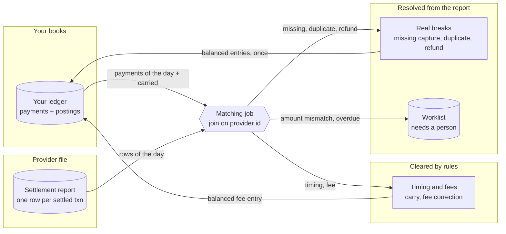

# Architecture: the daily reconciliation

Component names match the lesson's diagram ("One day of reconciliation, end to end"): **Your ledger**, **Settlement report**, **Matching job**, **Timing and fees** (the benign breaks cleared by rules) and **Real breaks** (what is resolved from the report, and what goes to a person).

## Components and what each owns

| Component | Where it lives | What it owns |
| --- | --- | --- |
| **Your ledger** (db) | tables `payments`, `journal_entries`, `postings`, `refunds` in [`sql/001_schema.sql`](sql/001_schema.sql); the capture path in [`application/record_capture.py`](src/payments_reconciliation/application/record_capture.py) | One row per captured payment, carrying the provider's own transaction id, and the append-only double-entry rows it posted. The database refuses an unbalanced entry and any edit to a posting. |
| **Settlement report** (store) | files `settlement_YYYY-MM-DD.csv` read through [`infrastructure/files.py`](src/payments_reconciliation/infrastructure/files.py); parsing in [`domain/settlement.py`](src/payments_reconciliation/domain/settlement.py) | The provider's rows: `provider_txn_id,amount,fee,status,settled_at`, one per settled capture and one negative row per refund. Malformed files are refused with the line number; nothing is skipped. |
| **Matching job** (service) | use case [`application/reconcile_day.py`](src/payments_reconciliation/application/reconcile_day.py), rules in [`domain/reconciliation.py`](src/payments_reconciliation/domain/reconciliation.py) | Builds the day's ledger view, joins on the provider's id, classifies each difference by cause, stores the breaks (one row per day, transaction, kind and cause) and the run's first-pass numbers. |
| **Timing and fees** (service) | carry logic in `reconcile_day.py`; the fee resolver in [`application/resolve_breaks.py`](src/payments_reconciliation/application/resolve_breaks.py) | Carries a late capture to the next report and clears it when it arrives; posts a balanced fee correction from the report's fee. |
| **Real breaks** (queue) | resolvers in `resolve_breaks.py`, table `reconciliation_breaks`, worklist in [`application/worklist.py`](src/payments_reconciliation/application/worklist.py) | Fixes a missing capture, a duplicate and a provider-only refund from the report's own data; leaves the amount mismatch (and anything else undecidable) on the worklist with its numbers. |
| **Daily report** | [`application/daily_report.py`](src/payments_reconciliation/application/daily_report.py) | Matched at the first pass, what rules cleared, what was fixed from the report, what needs a person, and a balance proof that partitions the settled total. |
| **Provider** (stub) | [`infrastructure/stub_provider.py`](src/payments_reconciliation/infrastructure/stub_provider.py) | Captures and refunds with idempotency keys; closes a settlement batch at a cutoff; can settle a different fee or amount than it captured. |
| **Day simulator** | [`infrastructure/simulation.py`](src/payments_reconciliation/infrastructure/simulation.py) | Drives a day of payments through the real capture path and plants the six breaks by their causes. |

## Pattern: layers, ports and adapters

The domain (money, the ledger entries, settlement rows, and the matching and classification rules) imports nothing but the standard library; the matcher is a pure function, so each cause is tested on its own with no database. The application layer holds the use cases and the ports (`PaymentProvider`, `SettlementFiles`, `UnitOfWork` with five repositories, `Clock`, `IdSource`). Infrastructure implements them with `psycopg`, the file system and the stub provider. Interfaces are the command-line program, the FastAPI application and the composition root. The dependency rule is checked by import-linter in `make lint`; a second contract keeps PostgreSQL and the web framework out of the domain and application.

This fits because the job has two inputs it does not control (a file and a database) and one risky output (ledger writes): ports at the edges let the unit tests run the real use cases, simulation included, against an in-memory unit of work, while the integration tests run the same code on PostgreSQL. Decisions: [ADR 0001](docs/adr/0001-join-on-the-providers-id-and-classify-by-cause.md), [0002](docs/adr/0002-resolve-from-the-report-never-by-calling-the-provider.md), [0003](docs/adr/0003-plant-the-breaks-through-the-real-path.md), [0004](docs/adr/0004-timing-is-a-cutoff-and-a-carry-with-a-limit.md).

## Data flow

Drawn versions of this figure and of the walk-through: [the architecture](docs/diagrams/architecture.svg) and [one run](docs/diagrams/flow.svg).

### One run, step by step (`make run`)

1. `rm -rf var/settlement` and `make db` give an empty ledger. The **Day simulator** runs 500 payments for 2026-10-18 through `RecordCapture` (a provider call, then the payment and six postings in one transaction) and writes the provider's file for the day, computed from the provider's own records.
2. The **Matching job** reads the file, loads the day's payments and the refunds recorded that day, joins on `provider_txn_id`, and finds nothing: `500 of 500 matched on the provider's transaction id, 0 breaks found`.
3. The planted day (2026-10-20) is simulated the same way with the six causes: the 50th capture after the 23:00 cutoff, a settlement-time fee on the 112th, a crash after the provider captured the 200th, a retry that recorded the 215th twice, a provider refund the service never heard about on the 300th, a settled amount of 99.99 on the 400th (captured at 95.00).
4. The job finds six breaks and prints `ptx_0050 timing`, `ptx_0112 fee_discrepancy`, `ptx_0200 missing_capture`, `ptx_0215 duplicate_on_our_side`, `ptx_0300 provider_only_refund`, `ptx_0400 amount_mismatch`. It stores them (`CARRIED`, `OPEN`, `NEEDS_REVIEW`) and the run's first-pass numbers: 494 transactions matched cleanly.
5. Resolution, one transaction per break under a lock on the break row, in a safe order: the missing capture is inserted from the report's amount and fee (six postings); the duplicate is reversed (the later payment's six postings are cancelled by six reversing postings) and marked `DUPLICATE_REVERSED`; the fee gets one entry of 0.18; the refund is posted from the report. Each break becomes `RESOLVED` or `AUTO_RESOLVED`. The timing difference stays `CARRIED`; the amount mismatch stays on the worklist.
6. Resolution runs again: each resolver reports `already resolved`, the ledger digest (a SHA-256 over every posting) is unchanged and the sum is `0.00`.
7. The day is reconciled again: only `ptx_0050` (carried) and `ptx_0400` (worklist) are unresolved. The **daily report** prints the matched count, the sections above and a balance line: settled total = clean + fee-corrected + resolved + worklist, with the open difference of 4.99 against the ledger explained by `ptx_0400`.
8. The next day (2026-10-21, 30 payments) is simulated and reconciled. The provider's new file contains `ptx_0050`; the carried break clears itself (`CLEARED`, with the date) and the day has no breaks. The worklist holds `ptx_0400` only.

## Decisions and trade-offs

**The provider's id is the only join key; a refund is a second kind of row under the same id** (ADR 0001). Matching on `(id, kind)` lets a capture match while its refund is still a break, which is exactly the provider-only refund.

**Classify first, then act.** `reconcile()` is pure: it takes the ledger view, the report, the carried days and the rules, and returns matches and breaks. Storing and fixing are separate use cases, so classification can be tested without a database and re-run without side effects.

**Breaks are rows keyed by (day, transaction, kind, cause).** Re-running a day updates the same rows. A resolved break that comes back is reopened; an open one that no longer reproduces is cleared. The run record keeps the first-pass numbers so the report can show them after the fixes.

**Fix from the report, never from the provider** (ADR 0002). The money has moved; the report is the authoritative record of how much. Fixes are entries, never edits: the fee correction is one balanced entry, the duplicate reversal is the capture's entries swapped, the refund is the refund entries.

**Three layers keep a resolution to one effect.** The resolver checks the ledger and says "already resolved"; the break row is locked so two workers queue; the ledger's unique key refuses a second posting of the same operation. A crash between ledger and status cannot happen because they commit together.

**The balance proof partitions the settled total.** Every settled row in the file lands in exactly one bucket (clean, cleared carried, auto-resolved, resolved, worklist, open), so the buckets must add up to the file's total; the report prints `[balances]` or `[DOES NOT BALANCE]`. The separate figure, the difference against the ledger, is the money still unexplained.

**Timing is a cutoff, a carry and a limit** (ADR 0004). A late capture waits; a transaction that does not arrive in `MAX_CARRY_DAYS` days goes to a person.

**Money is integer minor units**, as in the payments service; the settlement file's decimal text is parsed exactly and refused if it has more places than the currency.

**Operability.** Logs are `logfmt` on standard error with the transaction id and cause and never a card number or token (anything shaped like a card number is masked). `GET /health` checks the database (`503` when down), `GET /health/live` only the process. SIGTERM lets uvicorn finish in-flight requests, close the pool and exit 0 (an end-to-end test checks the exit code and the `shutdown complete` line). Settings come from the environment and are validated at startup; the password has no default and is never printed. Settlement files are written whole (temporary file, then rename), so a reader never sees half a file.

## Failure modes the lesson teaches, and how to reproduce each

| Failure | What you see | Reproduce |
| --- | --- | --- |
| **A clean day** | `500 of 500 matched ... 0 breaks found` | `make run`, section 1 |
| **Timing** (late capture) | `ptx_0050 timing`, `CARRIED`; on the next day `CLEARED` with no action | `make run`, sections 2 and 8 |
| **Fee not recorded correctly** | `ptx_0112 fee_discrepancy`; `fee corrected, +0.18 posted, ledger balanced` | `make run`, sections 2 and 3 |
| **Missing capture** (died after the provider captured) | `ptx_0200 missing_capture`; `inserted from settlement report, postings added` | `make run`; `tests/integration/test_reconciliation_on_postgres.py` |
| **Duplicate on our side** | `ptx_0215 duplicate_on_our_side`; `duplicate reversed, one capture retained` | `make run` |
| **Refund only the provider has** | `ptx_0300 provider_only_refund`; `refund posted from settlement report` | `make run` |
| **Amount mismatch** | `ptx_0400 amount_mismatch`, on the worklist with both amounts | `make run`; `payments-reconciliation worklist` |
| **A resolver run twice** | `already resolved` for each; ledger digest identical | `make run`, section 4; eight threads in `tests/integration` |
| **A fix that fails halfway** | no postings and no status change | `tests/integration/test_reconciliation_on_postgres.py` |
| **A timing difference that never settles** | `timing_overdue` on the worklist, the old row `ESCALATED` | `tests/unit/application/test_lesson_scenario.py` |
| **A malformed or missing file** | `settlement_missing` (404) or `settlement_format` (422) with the line number | `tests/unit` |

## Limits of the teaching build against production

- **The provider is a stub** with a settlement model of its own (one batch a day, one currency). A real report has more statuses (chargebacks, payouts, reserves), more files per day and its own cutoffs per payment method.
- **One currency per run.** The lesson's stretch goal reconciles in the transaction and the settlement currency; here a currency difference would surface as an amount mismatch.
- **The report is read whole into memory.** Fine for hundreds of thousands of rows; larger days stream the file and match in batches by id range.
- **Refund matching is by total per transaction and day.** Partial refunds over several days are matched day by day, not as a chain.
- **Carried differences are found by status, not by an index of expected settlement dates.** A provider that settles in `n` days needs a per-method expectation.
- **No alerting.** Thresholds on break counts per cause (a stretch goal) are not built; the counts are in `reconciliation_breaks` and the report.
- **A captured amount adjusted by the provider cannot be resolved without a person.** That is the lesson's point, and also a limit: there is no workflow for the person.
- **A single process, a throwaway local database password, no authentication on the API.**

## How to extend it

- **Multi-currency:** add the settlement currency and the rate to the file, compare in both currencies, and add a cause for a conversion difference.
- **Alerts:** count breaks by cause per run and fail the job (or notify) above a threshold per cause.
- **Fee schedule check:** give each payment method a fee rule and flag a settled fee above it as an overcharge, separate from the recording discrepancy.
- **A review workflow:** let a person close a `NEEDS_REVIEW` break with a reason, as a status the job never reopens.
- **A real provider:** replace the day simulator's file with the provider's download (SFTP or API) behind `SettlementFiles`.
